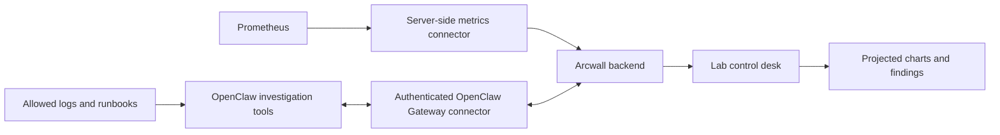

# Arcwall homelab plan

Status: proposed architecture. Arcwall currently runs locally; it is not connected to a homelab, Prometheus, or OpenClaw. The current animated telemetry is decorative.

## The useful end state

A third **Lab** workspace sits beside Studio and Mapping. It presents a living service map, actual CPU/memory/storage trends, current alerts, and an investigation panel. Ask “Why is the media server slow?” and see a time-bounded investigation: queries, timestamps, relevant log excerpts, source links, and a concise explanation. Pin a useful chart or finding to the projected canvas and move it with your hands.

Keep the controls on the laptop and the distilled information on the wall. An always-running service does not require the projector or webcam to run continuously.

## 1. Real metrics first

Add a server-side connector configured for one explicit Prometheus instance. Start with a small query catalog, 15-second refresh, bounded response sizes, timeouts, and an obvious last-updated/stale state. Private endpoint URLs and credentials stay on the server.

Use the Prometheus [HTTP API](https://prometheus.io/docs/prometheus/latest/querying/api/): instant queries for current values, range queries for trend charts, targets for scrape health, and alerts for firing/pending rules. The `up` metric reports scrape success, which is different from application health. Empty series must display as unavailable rather than zero.

Suggested initial cards:

| Signal                    | Data dependency                                   | Wall presentation                   |
| ------------------------- | ------------------------------------------------- | ----------------------------------- |
| Scrape health             | `up`                                              | Service nodes with explicit status  |
| CPU utilization           | node_exporter CPU counters                        | 30-minute sparkline and percentage  |
| Memory used               | node_exporter available/total memory              | Usage bar per host                  |
| Filesystem space          | node_exporter filesystem metrics, filtered mounts | Remaining space and trend           |
| HTTP reachability/latency | blackbox exporter or application metrics          | Reachability and latency chart      |
| Alerts                    | Prometheus alert rules                            | Active alert stack with start times |

Metrics and labels depend on the installed exporters. Grouping and filesystem filters need to match the actual lab rather than guessed hostnames. GPU, containers, Proxmox, and Kubernetes views can follow when their exporters are available.

**Acceptance:** unplug an exporter, observe the status change and timestamp, then disconnect Prometheus and see a stale/error state. Never silently replace missing live data with a simulated value.

## 2. OpenClaw investigation panel

Use the documented [external application Gateway interface](https://docs.openclaw.ai/gateway/external-apps) through a persistent server-side adapter. OpenClaw describes a WebSocket/RPC interface; verify the installed version, supported methods, authentication, pairing, and scopes before implementing the adapter. The browser should not receive a shared Gateway token.

Start with explicit, user-triggered investigations. Give the investigation tools read access to bounded Prometheus queries, selected logs, a service inventory, and selected runbooks. Display tool activity and evidence as the investigation progresses, with a cancel button. A model's conclusion should be visually distinguishable from the measurements supporting it.

“Agentic search” should mean searching those configured sources, choosing follow-up queries, and correlating a time window. Do not give the model an arbitrary shell or unrestricted network scanner as a first implementation. Any later restart, configuration change, or deployment should be a separate, concrete action for the user to review, with its result recorded.

**Acceptance:** ask about an actual alert, inspect the query and source timestamps, cancel an investigation, and recover cleanly from a Gateway disconnect. Unknown causes should remain unknown.

## 3. Projection-native findings

Introduce stable canvas object IDs for metric cards, timeseries charts, service nodes, and evidence notes. Agents propose typed scene operations such as `pin_chart`, `highlight_service`, and `add_note`; validate them before applying. Hands move and resize these objects using the existing interaction layer.

Do not render arbitrary agent-generated HTML. Keep data refresh separate from layout so new metrics do not move a user's pinned objects. Save layouts, not secret connection details or private log contents, in exported scene files.

**Acceptance:** pin a live chart, drag it, refresh its data, reconnect the projector, and preserve its placement and source identity.

## 4. Run reliably around the clock

Deploy a production build on an always-on homelab host using a supervised process or container with restart policy, health checks, structured logs, and a persistent connection adapter. Keep the existing local development setup separate. Next.js is enough for the first metrics routes; add a separate worker/service when persistent investigations and background jobs need it. FastAPI is optional, not a prerequisite.

Use an authenticated LAN/VPN endpoint for the control desk. A remote browser's webcam and microphone need a secure context; moving from loopback HTTP to a raw LAN HTTP address can break permissions. Provision HTTPS for that deployment.

A small client connected to the projector must keep the output browser open. The backend can stay up while the laptop is asleep, but a sleeping laptop cannot keep rendering its projector window. Provide a scheduled display mode, reduced animation/frame rate when idle, and recovery after browser/network restarts. Check the projector's own rated duty cycle before deciding on continuous projection.

**Acceptance:** reboot the host and output client, recover automatically, show reconnection state, and complete a 24-hour soak test with bounded CPU/memory use and no camera active unless explicitly enabled.

## Information needed to connect the real lab

- Host platform: Docker Compose, Proxmox VM, Kubernetes, or another setup.
- Prometheus URL reachable from the Arcwall server, authentication method, and available exporters.
- OpenClaw installation status, version, Gateway address, and preferred authentication/pairing method.
- Which services, log sources, and documents the investigation tools may read.
- What stays attached to the projector when the laptop is away.

Put credentials into server-side configuration or a secret store; do not paste them into GitHub issues, scene files, or the browser UI. No real connection or deployment is claimed until verified against those endpoints.
