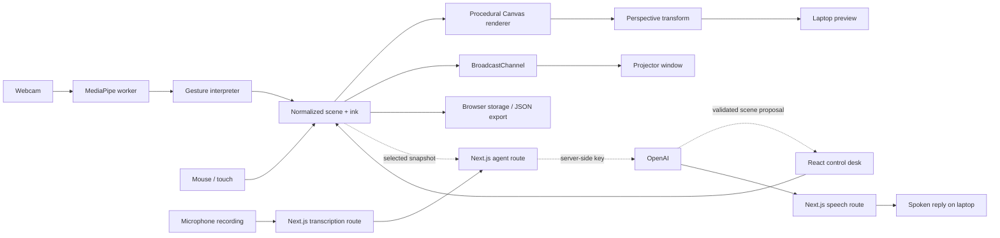

# Arcwall

**Turn an ordinary projector into a hand-controlled holographic workspace.**

A sci-fi projection studio inspired by the interfaces in Iron Man: a spatial grid, a rotating reactor core, a mechanical arm, seven background scenes, image-depth particles, and a drawing board you can control from your laptop or with your hands. Built as a small, local-first system with a path toward a drawing-aware voice agent.

## Run it

Requires Node.js 20.9+ and a modern browser. Chrome or Edge is recommended for camera tracking.

```sh
git clone https://github.com/tmanzhe/arcwall.git
cd arcwall
npm ci
npm run dev
```

Open **http://127.0.0.1:8787**. The projection studio and local commands work without an account, database, or AI key.

## Try it in two minutes

1. Draw directly on the live canvas. Pick an ink color, use **Erase** to cut through strokes, and **Undo** to restore an edit.
2. Select **Drawing board** for a clear grid. Use **Expand canvas** in the floating drawing dock to fill the workspace while keeping the tools available. Press **Escape** to return to the control desk.
3. Use the left navigation rail to open **Scene**, **Vision**, **Objects**, or **Setup** in the right inspector. Customize the reactor and arm, switch palettes, and add rectangle or ellipse outlines in **Objects**. Close the inspector for a wider canvas.
4. Try a local command: **“make the core bigger and turn it amber”**, **“hide the grid”**, or **“add a circle”**. These commands use a small deterministic parser, not an AI model.
5. Enable hand tracking, allow camera access, and hold your hand where the webcam can see it. In **Interact** mode, pinch over an object to grab it, move your hand, then release. Select an object and spread two open hands to resize it. Choose **Draw** or **Erase** for pinch-controlled ink. **Show my hand on the projection** independently controls the skeleton overlay.

## Connect a projector

1. Connect the projector to your laptop and select **extended display** in your operating system.
2. Click **Launch projector**. Move the new window to the projector display and press **F** for fullscreen.
3. Keep the control desk on the laptop. Changes and live ink are shared with the output window using `BroadcastChannel`; there is no screen capture or network video stream.
4. Choose **Fit to wall** in the floating toolbar and drag the four corner handles in the laptop preview. The application computes a perspective transform so the image fits a convex quadrilateral on the wall. Keep the projector still after alignment.
5. If pop-ups are blocked, allow them for the local app. Both windows must use the same browser profile and exact origin (`127.0.0.1:8787`, not a mixture of `localhost` and `127.0.0.1`).

The **Corner layout** action in the Scene inspector tucks the reactor into the upper-right and the arm into the lower-left, preserving ink, shapes, and wall alignment. Both objects have independent position and scale controls.

The renderer uses a 1920 × 1080 drawing surface and preserves its aspect ratio in the output. A flat wall, a small projection area, and a dark room make a good first setup.

## What is implemented

| Area              | Current behavior                                                                                                   |
| ----------------- | ------------------------------------------------------------------------------------------------------------------ |
| Holographic scene | Seven backgrounds: Arc lab, Guardian hand, Kinetic hand, Creation hands, Orbital, Constellation, Quiet grid        |
| Control desk      | Tabbed inspector, palette, intensity, motion speed, core and arm transforms, corner layout, layer toggles          |
| Drawing           | Mouse/touch ink, adjustable eraser, stroke splitting, undo, clear board, expanded board mode                       |
| Scene shapes      | Add, label, position, resize, recolor, and remove rectangles and ellipses                                          |
| Image mapping     | Local image upload, brightness relief, optional AI depth or uploaded depth, animated particle cloud, motion briefs |
| Interaction       | Mouse/touch dragging, pinch grabbing, two-hand resize of selected models, shapes, ink, and image cloud             |
| Wall fitting      | Four-point perspective mapping with crossed/degenerate corner rejection and inverse pointer mapping                |
| Vision            | Worker-based MediaPipe hand landmarks, smoothed pointer, pinch hysteresis, skeleton overlay, two-hand scaling      |
| Persistence       | Browser-local autosave, versioned JSON import/export, PNG snapshots                                                |
| Agent and voice   | Side-panel voice questions, canvas snapshots, spoken replies, local commands, and reviewable scene edits           |

The **Creation hands** scene is an original procedural 3D wireframe study inspired by the reaching hands in Michelangelo’s _The Creation of Adam_, matching the image referenced in [The Hand of God and the Story of a Soul](https://beyondthesestonewalls.squarespace.com/posts/the-hand-of-god-and-the-story-of-a-soul). It is not a scanned mesh or a bundled reproduction of that photograph.

The moving graphics and telemetry are visual effects. The reactor is a mathematical 3D wireframe projected onto a 2D canvas; the arm is an animated articulated drawing.

## Image mapping workspace

Switch the top workspace to **Mapping**. This hides the sci-fi decorations and opens an independent image-based scene; your Studio ink stays saved.

1. Choose **Try a local terrain demo** or upload a PNG/JPEG/WebP under 10 MB. Images are resized to a maximum 640-pixel edge and kept in the browser.
2. The instant fallback is labeled **Brightness relief**: bright pixels protrude. For inferred geometry, click **Estimate AI depth locally**, or upload a grayscale depth map where brighter means nearer.
3. The optional depth worker downloads [Depth Anything V2 Small](https://huggingface.co/onnx-community/depth-anything-v2-small) using [Transformers.js](https://huggingface.co/docs/transformers.js/en/index), then runs WASM inference in your browser. This produces relative depth from one image, not a physical scan or hidden geometry. The first run needs network access for model assets; you can cancel it.
4. Switch between **Pixels**, **Depth**, and **Image** previews. Adjust depth strength, density, size, colors, scale, orbit/push-in/drift/static motion, and pacing. Drag the cloud in **Interact** mode or use hands.
5. Try a brief such as “Slow orbit, neon particles, continuous 18 second shot.” The local parser recognizes supported camera movement, duration, speed, and colors. It does not call a video generator or invent new moving subjects, scenes, or audio.
6. Use the same projector window and four-corner fitting. Uploaded assets and Mapping settings are included in local autosave and JSON export.

Local AI depth has been exercised in the browser with the synthetic demo. Quality on real photographs and performance on other hardware still need evaluation.

## Optional drawing-aware agent

Copy `.env.example` to `.env.local`, add your own key, and restart the server:

```dotenv
OPENAI_API_KEY=your_key_here
OPENAI_MODEL=gpt-4.1-mini
```

The key is used only by the Next.js server route. Never put it in a `NEXT_PUBLIC_` variable or commit `.env.local`.

With a key configured, the scene panel sends your prompt and scene summary to OpenAI. **Include canvas** adds a rendered image of the drawing board; it does not include webcam video. This is enabled by default and can be turned off before sending. The model returns a constrained `update_scene` function call, and the UI presents proposed changes for you to apply. Changes operate on the current scene so a response does not overwrite newer ink or wall alignment. Use **Undo** after applying an edit to revert it.

The current agent can discuss a canvas snapshot, change supported visual parameters, and add labeled rectangles or ellipses. It does not yet generate arbitrary 3D models, rewrite freehand strokes, or continuously watch the canvas. Voice conversations currently use recorded turns; full-duplex streaming is a later milestone.

The route follows the [OpenAI Responses API image-input guide](https://developers.openai.com/api/docs/guides/images-vision) and uses a strict function schema. Live provider behavior requires an account with access to the configured model and available API quota.

## Talk about your canvas

1. Open **Assistant** in the left navigation rail. A side panel opens with a preview of the canvas context.
2. If prompted, configure `OPENAI_API_KEY` in `.env.local`, restart if needed, and select **Recheck connection**. The microphone button remains disabled until a key is configured.
3. Leave **Include canvas with each question** enabled to let the agent see your drawing. A fresh snapshot and matching scene settings are captured at the end of each voice recording. You can refresh the local preview without sending it.
4. Click **Talk to Arc**, allow microphone access, and ask something like “What do you think this drawing is?” Click **Finish question** to send. Recordings automatically finish after 30 seconds.
5. Read the transcript and reply in the conversation. With **Spoken replies** enabled, the answer also plays as an AI-generated voice. If autoplay is blocked, use **Play reply**.
6. **Cancel** stops a recording or in-flight turn. **Interrupt & talk** stops playback and starts another recording. Closing the panel releases the microphone and stops playback.

The flow is **record audio → transcribe → analyze the canvas and conversation → generate a spoken answer**. It uses the existing validated scene tools; a suggested scene edit still needs **Apply changes** and remains undoable. You can type instead of recording, or mute spoken replies.

Audio is sent to OpenAI for transcription only after a recording finishes. The model also receives your conversation, a bounded scene summary, and the canvas snapshot when enabled. Webcam video is never attached. Raw ink point arrays are omitted from the AI payload because the snapshot already contains the drawing. Audio clips and replies are not saved to disk by Arcwall.

Optional audio settings are in `.env.example`:

```dotenv
OPENAI_TRANSCRIBE_MODEL=gpt-4o-mini-transcribe
OPENAI_SPEECH_MODEL=gpt-4o-mini-tts
OPENAI_VOICE=cedar
```

The server uses the official [file transcription](https://developers.openai.com/api/docs/guides/speech-to-text) and [text-to-speech](https://developers.openai.com/api/docs/guides/text-to-speech) endpoints. These calls use your OpenAI API quota. The automated tests mock provider calls and exercise microphone cleanup; a real microphone-to-model conversation still needs validation with a configured key.

## Architecture



- **Next.js + React:** control desk, lifecycle, persistence, and optional API route.
- **Canvas 2D:** custom geometry, glow, ink, and frame rendering. The animation loop reads mutable interaction refs without requiring React updates on every frame.
- **Homography:** a pivoted linear solver maps a unit rectangle to four wall corners; the inverse maps mouse input back into drawing coordinates.
- **Web Worker + MediaPipe:** inference stays outside the rendering thread. Frames are transferred as `ImageBitmap` objects and closed after inference. The capture loop allows one inference in flight.
- **Shared scene model:** normalized coordinates make scenes independent of preview size. Imports and AI edits are bounded and validated.
- **No Python service yet:** FastAPI can be added when camera-to-wall calibration or more advanced Python vision warrants a separate backend.

## Development

```sh
npm test         # Geometry, gesture, eraser, and agent-boundary tests
npm run check    # Syntax checks for the non-JSX engine modules
npm run build    # Production Next.js build
npm start        # Serve the production build on 127.0.0.1:8787
npm run format   # Format project source
```

The tests exercise perspective round-trips, invalid surfaces, gesture transitions, tracking loss, two-hand scale clamping, sparse-stroke erasure, fast brush sweeps, import validation, and the allowed agent edit boundary. CI runs tests, syntax checks, formatting checks, and a production build.

## Keyboard controls

| Key    | Action                                       |
| ------ | -------------------------------------------- |
| V      | Interact / grab objects                      |
| Delete | Remove the selected object                   |
| D      | Draw                                         |
| E      | Erase                                        |
| M      | Fit to wall                                  |
| B      | Toggle drawing board / expanded workspace    |
| Z      | Undo                                         |
| Space  | Pause / resume visual motion                 |
| F      | Fullscreen                                   |
| H      | Hide / show the interface                    |
| Escape | Leave expanded workspace / restore interface |

## Current limits and next steps

- Hand positions are mapped from the mirrored webcam image like an air mouse. Precise tracing of a real wall needs a camera-to-projector calibration step; four-point wall fitting alone does not provide that calibration.
- The first camera session downloads MediaPipe JavaScript, WASM, and model assets. Webcam frames stay in the browser. Camera permission and real-world tracking quality depend on your browser, lighting, framing, and hardware.
- One quadrilateral is supported. Multiple independent mapped surfaces, resize handles, and general 3D mesh editing are next-stage work.
- The server is bound to loopback for personal use. Add authentication and abuse controls before exposing a configured AI route on the public internet.
- Hardware projection and model-backed AI calls require manual validation on the actual setup. Automated tests do not establish physical tracking accuracy or API availability.

Homelab metrics, OpenClaw investigations, and a 24/7 Lab workspace are planned in [HOMELAB.md](HOMELAB.md); none are connected yet.

See [ROADMAP.md](ROADMAP.md) for the staged plan and acceptance criteria.

## License

MIT. This is an independent project, not affiliated with Marvel or the Iron Man franchise.
