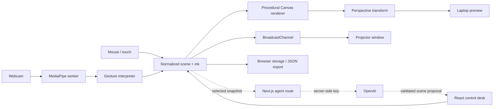

# Arcwall

**Turn an ordinary projector into a hand-controlled holographic workspace.**

A sci-fi projection studio inspired by the interfaces in Iron Man: a spatial grid, a rotating reactor core, a mechanical arm, and a drawing board you can control from your laptop or with your hands. Built as a small, local-first system with a path toward a drawing-aware voice agent.

## Run it

Requires Node.js 20.9+ and a modern browser. Chrome or Edge is recommended for camera tracking.

```sh
git clone https://github.com/tmanzhe/arcwall.git
cd arcwall
npm ci
npm run dev
```

Open **http://127.0.0.1:8787**. The projection studio and local commands work without an account, database, or AI key.

## Try it in two minutes

1. Draw directly on the live canvas. Pick an ink color, use **Erase** to cut through strokes, and **Undo** to restore an edit.
2. Select **Drawing board** for a clear grid with more drawing space. **Expand** fills the workspace while keeping the toolbar available. Press **Escape** to return to the control desk.
3. Customize the reactor's position and size, switch color palettes, and add rectangle or ellipse outlines from **Scene shapes**.
4. Try a local command: **“make the core bigger and turn it amber”**, **“hide the grid”**, or **“add a circle”**. These commands use a small deterministic parser, not an AI model.
5. Enable hand tracking, allow camera access, and hold your hand where the webcam can see it. Point to aim, pinch to draw or erase, and spread two open hands to resize the reactor.

## Connect a projector

1. Connect the projector to your laptop and select **extended display** in your operating system.
2. Click **Launch projector**. Move the new window to the projector display and press **F** for fullscreen.
3. Keep the control desk on the laptop. Changes and live ink are shared with the output window using `BroadcastChannel`; there is no screen capture or network video stream.
4. Choose **Fit to wall** and drag the four corner handles in the laptop preview. The application computes a perspective transform so the image fits a convex quadrilateral on the wall. Keep the projector still after alignment.
5. If pop-ups are blocked, allow them for the local app. Both windows must use the same browser profile and exact origin (`127.0.0.1:8787`, not a mixture of `localhost` and `127.0.0.1`).

The renderer uses a 1920 × 1080 drawing surface and preserves its aspect ratio in the output. A flat wall, a small projection area, and a dark room make a good first setup.

## What is implemented

| Area              | Current behavior                                                                                              |
| ----------------- | ------------------------------------------------------------------------------------------------------------- |
| Holographic scene | Procedural wireframe sphere with orbiting rings, articulated arm, animated grid, decorative telemetry         |
| Control desk      | Palette, intensity, motion speed, core scale and position, layer toggles                                      |
| Drawing           | Mouse/touch ink, adjustable eraser, stroke splitting, undo, clear board, expanded board mode                  |
| Scene shapes      | Add, label, position, resize, recolor, and remove rectangles and ellipses                                     |
| Wall fitting      | Four-point perspective mapping with crossed/degenerate corner rejection and inverse pointer mapping           |
| Vision            | Worker-based MediaPipe hand landmarks, smoothed pointer, pinch hysteresis, skeleton overlay, two-hand scaling |
| Persistence       | Browser-local autosave, versioned JSON import/export, PNG snapshots                                           |
| Agent foundation  | Local scene commands; optional image-aware OpenAI route that proposes validated, undoable edits               |

The moving graphics and telemetry are visual effects. The reactor is a mathematical 3D wireframe projected onto a 2D canvas; the arm is an animated articulated drawing.

## Optional drawing-aware agent

Copy `.env.example` to `.env.local`, add your own key, and restart the server:

```dotenv
OPENAI_API_KEY=your_key_here
OPENAI_MODEL=gpt-4.1-mini
```

The key is used only by the Next.js server route. Never put it in a `NEXT_PUBLIC_` variable or commit `.env.local`.

With a key configured, the scene panel sends your prompt and scene summary to OpenAI. **Attach canvas snapshot** explicitly includes a rendered image of the drawing board; it does not include webcam video. The model returns a constrained `update_scene` function call, and the UI presents proposed changes for you to apply. Changes operate on the current scene so a response does not overwrite newer ink or wall alignment. Use **Undo** after applying an edit to revert it.

The current agent can change supported visual parameters and add labeled rectangles or ellipses. It does not yet generate arbitrary 3D models, rewrite freehand strokes, continuously watch the canvas, or conduct live voice conversations. Full-duplex voice is a planned milestone, not a hidden requirement for the projection studio.

The route follows the [OpenAI Responses API image-input guide](https://developers.openai.com/api/docs/guides/images-vision) and uses a strict function schema. Live provider behavior requires an account with access to the configured model and available API quota.

## Architecture



- **Next.js + React:** control desk, lifecycle, persistence, and optional API route.
- **Canvas 2D:** custom geometry, glow, ink, and frame rendering. The animation loop reads mutable interaction refs without requiring React updates on every frame.
- **Homography:** a pivoted linear solver maps a unit rectangle to four wall corners; the inverse maps mouse input back into drawing coordinates.
- **Web Worker + MediaPipe:** inference stays outside the rendering thread. Frames are transferred as `ImageBitmap` objects and closed after inference. The capture loop allows one inference in flight.
- **Shared scene model:** normalized coordinates make scenes independent of preview size. Imports and AI edits are bounded and validated.
- **No Python service yet:** FastAPI can be added when camera-to-wall calibration or more advanced Python vision warrants a separate backend.

## Development

```sh
npm test         # Geometry, gesture, eraser, and agent-boundary tests
npm run check    # Syntax checks for the non-JSX engine modules
npm run build    # Production Next.js build
npm start        # Serve the production build on 127.0.0.1:8787
npm run format   # Format project source
```

The tests exercise perspective round-trips, invalid surfaces, gesture transitions, tracking loss, two-hand scale clamping, sparse-stroke erasure, fast brush sweeps, import validation, and the allowed agent edit boundary. CI runs tests, syntax checks, formatting checks, and a production build.

## Keyboard controls

| Key    | Action                                       |
| ------ | -------------------------------------------- |
| D      | Draw                                         |
| E      | Erase                                        |
| M      | Fit to wall                                  |
| B      | Toggle drawing board / expanded workspace    |
| Z      | Undo                                         |
| Space  | Pause / resume visual motion                 |
| F      | Fullscreen                                   |
| H      | Hide / show the interface                    |
| Escape | Leave expanded workspace / restore interface |

## Current limits and next steps

- Hand positions are mapped from the mirrored webcam image like an air mouse. Precise tracing of a real wall needs a camera-to-projector calibration step; four-point wall fitting alone does not provide that calibration.
- The first camera session downloads MediaPipe JavaScript, WASM, and model assets. Webcam frames stay in the browser. Camera permission and real-world tracking quality depend on your browser, lighting, framing, and hardware.
- One quadrilateral is supported. Multiple independent mapped surfaces, shape grabbing, and general 3D object editing are next-stage work.
- The server is bound to loopback for personal use. Add authentication and abuse controls before exposing a configured AI route on the public internet.
- Hardware projection and model-backed AI calls require manual validation on the actual setup. Automated tests do not establish physical tracking accuracy or API availability.

See [ROADMAP.md](ROADMAP.md) for the staged plan and acceptance criteria.

## License

MIT. This is an independent project, not affiliated with Marvel or the Iron Man franchise.
